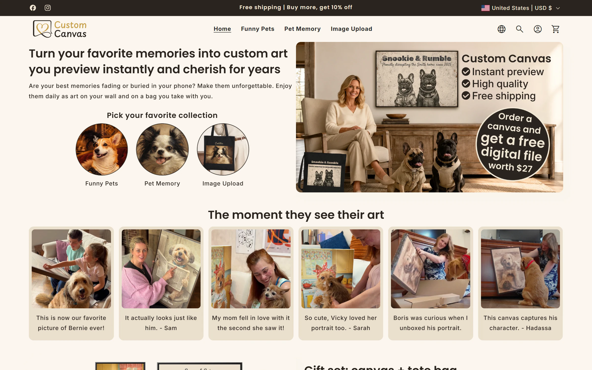
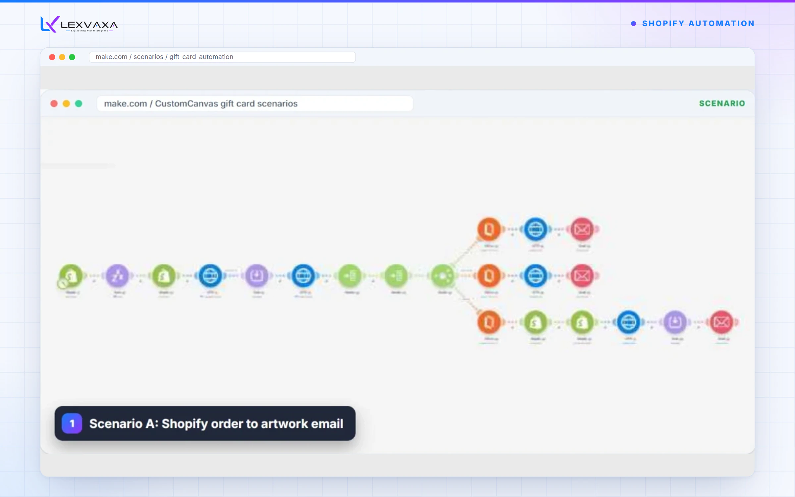

# Custom Canvas

**An online store that turns pet photos and family memories into custom canvas art and tote bags, with an instant preview before ordering.**

      

## Overview

Custom Canvas is an e-commerce store for personalised wall art. Customers choose a style from the Funny Pets or Pet Memory collections, or upload their own image, see a preview of their canvas or tote bag right away and order in a few clicks. The store includes a canvas and tote bag gift set, a printable gift card for gifting, customer reviews and photo moments, and shipping across countries and currencies.

## The challenge

Custom art is hard to buy online: customers want to see the result before paying, and gift buyers need a simple way to order for someone else.

## The solution

A clear storefront built around instant previews, ready-made character and portrait styles, a three step ordering flow and gift options that make the product easy to give.

## Key features

- Instant preview of the custom canvas or tote bag
- Funny Pets and Pet Memory style collections
- Upload your own image for canvases and bags
- Three step ordering: pick, upload and preview, order
- Canvas and tote bag gift set
- Printable gift card for gifting
- Customer reviews and unboxing moments
- Multi-currency storefront with free shipping
- Shopify order to artwork email automation in Make

## Tech stack

Shopify · Liquid · JavaScript · Image upload and preview · Make

## Screens

## Live

https://customcanvas.store/

## Privacy

Client names and records are confidential. Every screen in this repository uses sample data, and source code that belongs to the client is not published.

## Links

- Case study on Lexvaxa: https://lexvaxa.com/work/custom-canvas
- Built by **Ch Muhammad Samiullah** ([GitHub](https://github.com/samiullah156-creator)) at [Lexvaxa](https://lexvaxa.com)
